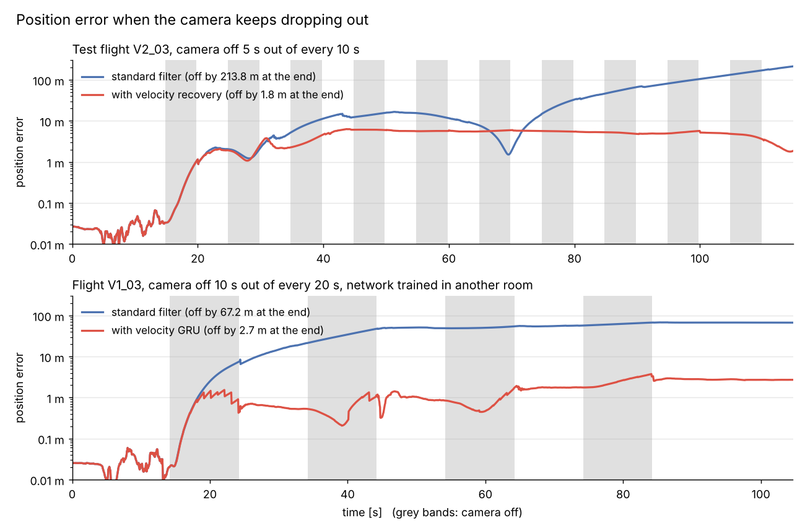

# learned-attitude-msckf

**Monocular visual-inertial odometry for drones, with learned IMU models, written from scratch in Python.**
On the EuRoC MAV test flights it is **38% more accurate than OpenVINS**, and it
**keeps tracking through camera outages** that make a standard filter diverge.

<p align="center">
  
</p>

*With the camera switched off again and again (grey bands), a standard
filter loses track and its error climbs to tens or hundreds of metres. The
velocity recovery (top) and the velocity GRU (bottom, a network trained in a
different room) keep it within a few metres.*

## Highlights

| | what it does | result |
|---|---|---|
| **MSCKF filter** | Error-state EKF over a sliding window of camera poses, one camera plus IMU | 0.088 m trajectory error on the test flights, against 0.143 m for OpenVINS v2.7 |
| **Takeoff detector** | Finds when the motors start and when the drone lifts off, and measures the gyro bias in between | Bias error cut from about 5 deg/s to 0.13–0.16 deg/s, with no ground truth |
| **Residual attitude GRU** | Learns a small correction on top of gyro integration, starting from the takeoff detector's bias | 19% less attitude drift from the IMU alone |
| **Velocity GRU** | Estimates the drone's velocity from one second of IMU data, with its own uncertainty, while the camera is off | 20% less drift over 10 s outages; no divergence in a room it never saw |
| **Velocity recovery** | Solves for the velocity in closed form when the camera returns | Drift in the worst 10% of 5 s outages cut from 17.9 m to 1.2 m |

Everything starts from a cold start: the filter finds its own still period,
gravity and biases, and uses no ground truth at run time.
The OpenVINS baseline is run and scored with the same code, the trained
networks are included, and one script reproduces every table.

<p align="center">
  
  
</p>

*Left: the takeoff detector on V2_01, measuring the gyro bias while the
motors spin up on the ground. Right: the OpenVINS baseline on the same
flight.*

## How it works

**1. Start-up without ground truth.** Before a drone takes off it sits still
with its motors spinning. The takeoff detector combines IMU stillness, the
motors' vibration signature and image motion to find that window, and
averages the gyro there to get its bias. It found the takeoff in 9 of the 11
EuRoC flights.

**2. The filter.** A multi-state constraint Kalman filter (MSCKF) tracks
attitude, position, velocity and both IMU biases, plus the last 11 camera
poses. KLT feature tracks constrain those poses without keeping landmarks
in the state. It is consistent in simulation (NEES about 3).

**3. A learned gyro model.** A small GRU reads each 50 ms of IMU data and
predicts a residual rotation that is added to plain gyro integration, so it
only has to learn what integration gets wrong. Feeding it the takeoff
detector's bias first is what made it stable over a whole flight.

**4. Flying blind.** When the camera drops out, position error grows because
velocity error grows. A second GRU ensemble estimates the body-frame velocity
from the last second of IMU data, using rotor drag, and the filter takes it
as a measurement once a second. When the camera comes back, the velocity is
solved again from the first second of images, so the filter cannot lock
onto a wrong velocity and reject every new feature.

## Results

Unless noted, numbers are on the three V2 flights, held out from all
training and tuning. Trajectories are aligned to ground truth in yaw and
position.

**Accuracy with the camera on**

| | position error (ATE) | attitude error |
|---|---|---|
| OpenVINS v2.7 | 0.143 m | 1.41° |
| this filter | **0.088 m** | **1.31°** |

<p align="center">
  
</p>

**Camera switched off for 10 s, repeatedly** (median drift per outage)

| | drift per outage | error over the whole flight |
|---|---|---|
| filter alone | 2.29 m | 1.80 m |
| + velocity GRU | **1.84 m** | **1.40 m** |

**The same network in a room it was not trained in** (trained on the
machine hall only, flown on the V1 flights in the Vicon room, 10 s outages)

| | worst 10% of outages | error over the whole flight |
|---|---|---|
| filter alone | 11.2 m | 9.81 m |
| + velocity GRU | **2.10 m** | **1.18 m** |

**Velocity recovery after 5 s outages**

| | worst 10% of outages | error over the whole flight |
|---|---|---|
| without recovery | 17.9 m | 17.9 m |
| with recovery | **1.18 m** | **1.26 m** |

## What did not work

Kept here because the negative results are part of the work:

- **The attitude GRU does not improve the full filter.** Most of what it
  learned is a better integration rule, and midpoint integration, which the
  filter already uses, does as well.
- **At 10 s outages a simple "velocity is about zero" prior helps almost as
  much as the velocity GRU** when both are applied once a second. Applied
  twice a second, the network pulls ahead (20% lower median drift).
- **The filter is overconfident on real data** (attitude NEES in the
  hundreds), most likely from calibration or timing errors it does not model.

Every table, ablation and design choice is in
[`docs/details.md`](docs/details.md).

## Running it

Python 3.10 or newer. A CPU is enough, including for the GRU fine-tuning.

```bash
git clone --single-branch https://github.com/AghyadA1/learned-attitude-msckf.git
cd learned-attitude-msckf
pip install -e ".[gru,dev]"
pytest -q
```

**Data.** EuRoC is hosted on the
[ETH Research Collection](https://doi.org/10.3929/ethz-b-000690084). Download
the machine hall and Vicon room archives into one folder, then

```bash
python scripts/prepare_euroc.py unpack --zips ~/Downloads/euroc --out data/euroc
```

Any copy in the ASL layout (`<sequence>/mav0/...`) works; pass its folder as
`--euroc`.

**Everything at once.**

```bash
bash scripts/reproduce.sh data/euroc
```

This checks the data, runs the tests, detects takeoff, calibrates and
fine-tunes the gyro GRU, scores the velocity GRU, runs every filter variant
on all sequences plus the V2 outage runs, and scores them. All trained
networks are in `models/`, and a network is only trained or calibrated again
if its file is missing. Finished runs are skipped, so it can be restarted.
`JOBS=4` sets the number of parallel filter runs. If you have
OpenVINS exports, pass their folder as a second argument to score them with
the same code.

**One step at a time.**

```bash
python scripts/detect_takeoff.py --euroc data/euroc --video
python scripts/train_gru.py calibrate --euroc data/euroc --checkpoint models/gru_preflight.pt --out models/gru_preflight_cal.pt
python scripts/train_gru.py train --euroc data/euroc --init models/gru_preflight.pt --out models/gru_filter.pt
python scripts/train_gru.py calibrate --euroc data/euroc --checkpoint models/gru_filter.pt --out models/gru_filter_cal.pt
python scripts/train_gru.py compare --euroc data/euroc original=models/gru_preflight.pt fine-tuned=models/gru_filter.pt
python scripts/train_velocity.py train --euroc data/euroc --members 3 --out models/velocity_gru.pt
python scripts/train_velocity.py evaluate --euroc data/euroc --checkpoint models/velocity_gru.pt
python scripts/run_vio.py --euroc data/euroc --variant msckf gru-filter --sequences V2_01_easy
python scripts/run_vio.py --euroc data/euroc --variant msckf gru-velocity gru-both --outage 10 --sequences V2_01_easy
python scripts/evaluate.py --euroc data/euroc
python scripts/plot_outage_error.py --euroc data/euroc
```

`models/gru_preflight.pt` is the trained network from the original project,
unchanged (SHA-256 `bfd22f8e…4bc3`).

**Without running the filter.** The filter runs behind every table (one
`.npz` per variant and flight, 490 MB) and the cached feature tracks
(150 MB) are on the separate `runs` branch, so a normal clone of `main`
does not download them. Copied into the repository folder, they let
`reproduce.sh` skip every filter run and go straight to scoring:

```bash
git fetch origin runs
git archive FETCH_HEAD runs cache | tar -x
```

## Layout

```
qvio/
  so3.py        rotations and quaternions (xyzw, Hamilton)
  euroc.py      EuRoC reader; ground truth is loaded separately
  frontend.py   KLT tracker
  msckf.py      the filter
  pipeline.py   cold start and the per-frame loop
  gru.py        the attitude GRU as a gyro model
  velocity.py   the velocity GRU and its control
  recovery.py   velocity from the camera and IMU after an outage
  takeoff.py    takeoff detection and preflight calibration
  metrics.py    ATE, RPE, tilt, NEES, outage drift
scripts/        data preparation, training, runs, scoring, reproduce.sh
baselines/openvins/   offline OpenVINS runner, patch and configuration
results/        tables from the original project and from the scripts
docs/           full results (details.md), side experiments and media
tests/          unit tests and a simulated flight
```

## References

- M. Burri et al., *The EuRoC micro aerial vehicle datasets*, IJRR 2016.
- A. Mourikis and S. Roumeliotis, *A multi-state constraint Kalman filter for
  vision-aided inertial navigation*, ICRA 2007.
- G. Huang, A. Mourikis and S. Roumeliotis, *Analysis and improvement of the
  consistency of extended Kalman filter based SLAM*, ICRA 2008.
- P. Geneva et al., *OpenVINS: A research platform for visual-inertial
  estimation*, ICRA 2020.
- Y. Qiu et al., *AirIO: Learning inertial odometry with enhanced IMU
  feature observability*, IEEE RA-L 2025.
- W. Liu et al., *TLIO: Tight learned inertial odometry*, IEEE RA-L 2020.
- G. Cioffi et al., *Learned inertial odometry for autonomous drone
  racing*, IEEE RA-L 2023.
- A. Martinelli, *Closed-form solution of visual-inertial structure from
  motion*, IJCV 2014.
- R. Leishman et al., *Quadrotors and accelerometers: State estimation with
  an improved dynamic model*, IEEE Control Systems Magazine 2014.
- B. Lakshminarayanan, A. Pritzel and C. Blundell, *Simple and scalable
  predictive uncertainty estimation using deep ensembles*, NeurIPS 2017.

## Licence

MIT, except `baselines/openvins/`, which builds on OpenVINS and is GPL-3.0.
