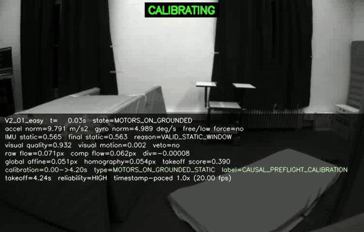
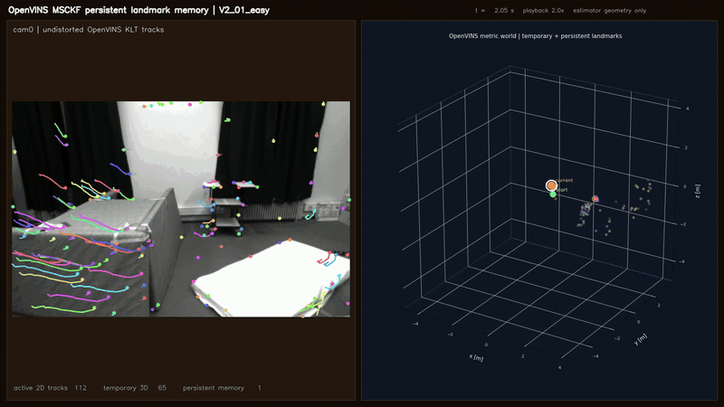
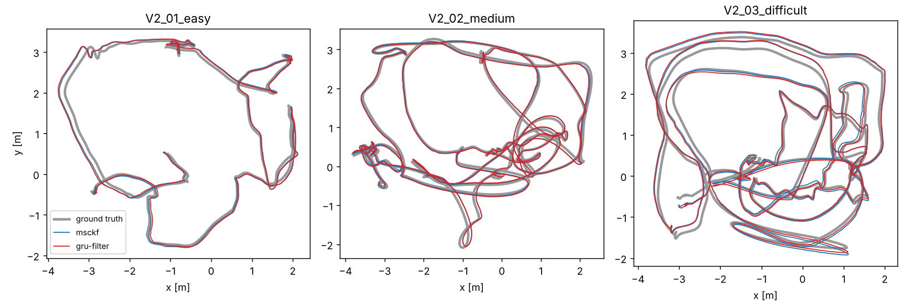
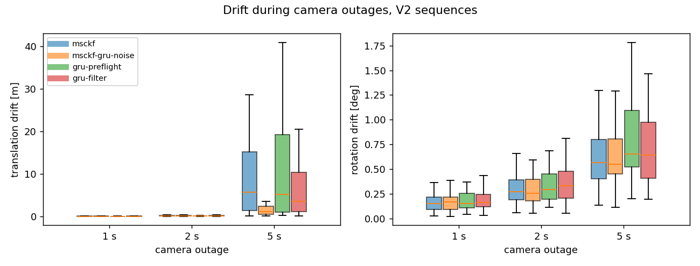
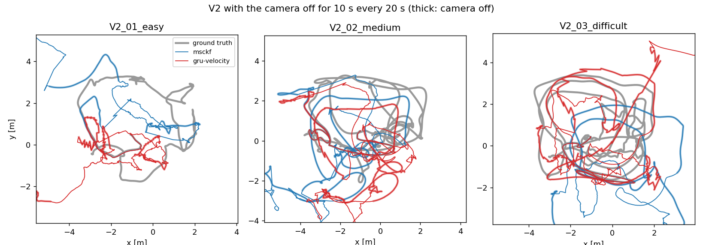

# learned-attitude-msckf

Monocular visual-inertial odometry on the EuRoC MAV dataset, written in
Python. It grew out of my fifth-year project and has four parts:

- an **MSCKF** (an error-state EKF over a sliding window of camera poses) that
  starts from a still period it finds on its own, with no ground truth, and
  re-estimates its velocity from the camera when it comes back after an
  outage;
- a small **GRU that corrects 50 ms of gyro integration**, used inside the
  filter as a learned gyro model;
- a **velocity GRU** that estimates the drone's velocity from the last
  second of IMU data, which the filter uses while the camera is off;
- a **takeoff detector** that finds when the motors start and the drone
  leaves the ground, and calibrates the gyro bias in between.

OpenVINS v2.7, run as a monocular MSCKF with the same window size, is the
reference.

<p align="center">
  
  
</p>

*Left: V2_01. The gyro bias is measured while the motors spin up and the
drone is still on the ground, and the detector marks the moment it lifts
off. Right: the OpenVINS baseline on the same flight, with KLT tracks and the
landmarks it triangulates.*

## Results

Training uses MH_01 to MH_04 and V1_01 to V1_03, MH_05 is for validation, and
everything below is on the three V2 sequences unless it says otherwise.

### Gyro bias from the pre-flight still period

| sequence | motors on [s] | takeoff [s] | calibration interval [s] | bias error [deg/s] |
|---|---|---|---|---|
| V2_01_easy | 0.25 | 4.25 | 0.0 – 4.2 | 0.160 |
| V2_02_medium | 0.25 | 3.35 | 0.0 – 2.7 | 0.147 |
| V2_03_difficult | 0.35 | 5.15 | 0.3 – 5.1 | 0.131 |

The detector combines IMU stillness, the vibration signature of the motors
and image motion, which can veto a "still" verdict when the camera is
clearly moving. It found the takeoff in 9 of the 11 sequences. MH_01 and
MH_02 begin with the drone already being carried, so it falls back to a
later still period and marks that calibration as non-causal.

The raw gyro bias is about 5 deg/s; after calibration the remaining error
is 0.13 to 0.16 deg/s on V2. That error is measured against EuRoC's
reference bias, which is itself a batch estimate rather than a direct
measurement. All eleven sequences are in
[`results/takeoff/reference_original_detector.csv`](results/takeoff/reference_original_detector.csv).

### The gyro GRU on its own, without the camera

Attitude error in degrees when integrating the IMU alone:

| | one 50 ms window | 1 s (20 windows chained) | whole flight, mean | whole flight, at the end |
|---|---|---|---|---|
| gyro minus preflight bias | 0.033 | 0.227 | 3.16 | 6.60 |
| GRU, first version | 0.030 | 0.323 | 13.57 | 45.83 |
| GRU, bias-corrected prior | **0.025** | 0.231 | **2.57** | **5.53** |
| gyro minus EuRoC reference bias | 0.032 | 0.182 | 0.92 | 1.24 |

The network is one GRU layer with 96 units. It reads the ten IMU samples of
a camera interval (gyro with the bias removed, plus accelerometer) and
predicts a small rotation, at most 0.15 rad per axis, that is applied after
plain integration. The first version used the raw gyro as its prior and
drifted badly on V2_03; subtracting the preflight bias first fixed that.

Per-split numbers are in
[`results/gru/attitude_only_errors.csv`](results/gru/attitude_only_errors.csv).
In that evaluation the gyro was integrated with the rectangle rule, holding
each 5 ms sample constant until the next one, and that is what the network
beat by 23%. The midpoint rule, which the filter uses, does better than the
network without learning anything:

| one 50 ms window, reference bias removed [deg] | MH_05 (validation) | V2 (test) |
|---|---|---|
| gyro, rectangle rule | 0.0169 | 0.0321 |
| GRU, original | 0.0101 | 0.0247 |
| GRU, fine-tuned for the filter | 0.0075 | 0.0231 |
| gyro, midpoint rule | **0.0009** | **0.0184** |

The rectangle-rule row matches the original evaluation to four decimals, so
the two tables measure the same thing
([`results/gru/window_errors.csv`](results/gru/window_errors.csv)). Most of
what the network learned is a better integration rule. The midpoint rule's
very close match on MH_05 is probably helped by EuRoC's reference attitude
being fitted to this same IMU (see the caveats), but it also wins on V2.

Over longer horizons the bias dominates, and a 50 ms window cannot see it.
That is the reason to try the network inside a filter that estimates the
bias, rather than on its own.

### Full visual-inertial odometry

All trajectories are aligned to ground truth with a yaw rotation and a
translation (4-DoF). The OpenVINS baseline is described in
[`baselines/openvins`](baselines/openvins). Its exported trajectories are
scored below with the same code as the Python filter; the numbers from the
original project are in
[`results/openvins/euroc_openvins_v2.7.csv`](results/openvins/euroc_openvins_v2.7.csv).
The Python filter runs in four variants, all from the same cold start:

| variant | gyro model | gyro noise |
|---|---|---|
| `msckf` | plain gyro | sensor datasheet |
| `msckf-gru-noise` | plain gyro | the fine-tuned GRU's error, measured on MH_05 |
| `gru-preflight` | the GRU above, unchanged | its error, measured on MH_05 |
| `gru-filter` | the GRU fine-tuned for the filter | predicted by the network, scaled on MH_05 |

`msckf-gru-noise` is the control. It tells the filter the gyro is as noisy
as the fine-tuned GRU, but integrates the plain gyro. Mean over the three V2
sequences:

| | ATE RMSE [m] | attitude RMSE [deg] | velocity RMSE [m/s] | attitude NEES |
|---|---|---|---|---|
| OpenVINS v2.7 | 0.143 | 1.41 | 0.058 | |
| `msckf` | **0.088** | **1.31** | 0.036 | 252 |
| `msckf-gru-noise` | 0.089 | **1.31** | **0.035** | 135 |
| `gru-preflight` | 0.104 | 1.39 | 0.037 | 131 |
| `gru-filter` | 0.098 | 1.32 | 0.036 | 136 |

<p align="center">
  
</p>

The Python filter is more accurate than OpenVINS on V2, and the gyro GRU
does not improve it: both GRU variants are a centimetre or two worse than
the plain gyro, and the control matches the plain gyro. The training
sequences say the same, with mean ATE 0.20 m for `msckf`, 0.28 m for the
control and 0.24 m and 0.22 m for the two GRU variants (OpenVINS 0.47 m,
most of it on MH_03). Per-sequence numbers are in
[`results/vio/ate_per_sequence.md`](results/vio/ate_per_sequence.md) and
[`results/vio/full_sequences.csv`](results/vio/full_sequences.csv).

The accelerometer noise density in the filter is 7 times the datasheet
value. With the datasheet value the filter was overconfident about its
velocity, tilt and accelerometer bias: on V2 its ATE was 0.138 m, and after
5 s camera outages it never recovered on four of the eight training and
validation sequences. Of 1, 5, 7, 10 and 20 times the datasheet
value, 7 gave the lowest ATE on the training and validation sequences, and
V2 was not used to choose it. The attitude NEES is still in the hundreds
where a consistent filter gives 3, mostly from tilt: the filter settles
about half a degree away from EuRoC's reference tilt while its own standard
deviation is a few hundredths of a degree. The same filter is consistent in
simulation (below), so the extra error probably comes from something the
model leaves out, such as calibration or timing errors.

Two other problems turned up on the way to these numbers. The filter used
to drop features with less than 1° of parallax, so during a ten-second hover
on MH_04 it received no updates and drifted 7 m; without that gate it is
at 0.31 m there, against 0.37 m for OpenVINS. And measuring the plain
gyro's noise against EuRoC's reference gives a variance 4 to 50 times below
the datasheet's, probably because the reference attitude is fitted to the
same IMU, which is why the control borrows the GRU's noise instead.

### Camera outages

A learned model should matter most when the camera drops out. Each variant
was run again on V2 with the camera switched off for 1, 2, 5 or 10 s,
starting 15 s after initialisation and repeating every 10 s (every 20 s for
the 10 s gaps, so the camera is always back for at least as long as it was
off). The tracker restarts after every gap. Three more variants use the
velocity GRU described below, or a control for it:

| variant | gyro model | while the camera is off |
|---|---|---|
| `gru-velocity` | plain gyro | velocity GRU, once a second |
| `gru-both` | `gru-filter` | velocity GRU, once a second |
| `msckf-speed-prior` | plain gyro | "the velocity is zero", with the spread of the training velocities as its uncertainty, once a second |

Every variant re-estimates its velocity from the camera after each gap when
it needs to (see [below](#getting-the-velocity-back-after-a-gap)).

Position drift over a gap on V2, median of 30 gaps (15 for 10 s):

| variant | 1 s | 2 s | 5 s | 10 s |
|---|---|---|---|---|
| `msckf` | 0.057 m | 0.140 m | 0.61 m | 2.29 m |
| `msckf-gru-noise` | **0.049 m** | **0.124 m** | 0.68 m | 2.26 m |
| `gru-preflight` | 0.058 m | 0.136 m | 0.78 m | 2.80 m |
| `gru-filter` | 0.059 m | 0.150 m | 0.68 m | 2.44 m |
| `msckf-speed-prior` | 0.056 m | 0.146 m | 0.63 m | 1.87 m |
| `gru-velocity` | 0.059 m | 0.150 m | 0.65 m | 1.84 m |
| `gru-both` | 0.056 m | 0.143 m | **0.57 m** | **1.54 m** |

The worst 10% of gaps, and the error over the whole flight (ATE, mean of
the three flights):

| variant | 5 s, 90th pct. | 10 s, 90th pct. | 5 s, whole flight | 10 s, whole flight |
|---|---|---|---|---|
| `msckf` | 1.18 m | 3.54 m | 1.26 m | 1.80 m |
| `msckf-gru-noise` | 1.24 m | 3.87 m | 1.09 m | 1.71 m |
| `gru-preflight` | 1.36 m | 3.76 m | 1.61 m | 3.33 m |
| `gru-filter` | 1.25 m | 4.65 m | 0.97 m | 3.17 m |
| `msckf-speed-prior` | **1.10 m** | **2.82 m** | 0.88 m | 1.43 m |
| `gru-velocity` | 1.17 m | 2.91 m | 0.93 m | **1.40 m** |
| `gru-both` | 1.20 m | 3.29 m | **0.63 m** | 2.16 m |

<p align="center">
  
  
</p>

For 1 and 2 s gaps the differences are a centimetre or two either way: the
filter's own velocity is still good, and the rotation drift is 0.15° to
0.35° for every gyro model.

With 5 s gaps the velocity GRU gives a small but consistent gain. Per
flight (V2_01, V2_02, V2_03) its median drift is 0.51, 0.39 and 0.78 m,
against 0.61, 0.49 and 0.80 m for `msckf` and 0.59, 0.46 and 0.80 m for
the speed prior. Gap by gap, it drifts less than `msckf` in 60% of the
gaps and less than the speed prior in 63%, by 6 and 5 cm on average. The
pooled median above hides this because the three flights have different
drift levels. With both GRUs the median is lowest (0.57 m), and so is the
whole-flight error (0.63 m against 1.26 m for `msckf`).

With 10 s gaps the velocity GRU cuts the median drift from 2.29 m to
1.84 m (20%), the worst 10% from 3.5 m to 2.9 m, and the whole-flight
error from 1.80 m to 1.40 m. The speed-prior control does as well here
(1.87 m), so at this rate the gain at 10 s on V2 cannot be credited to
what the network learned, only to bounding the velocity at all. Applied
twice a second, the network is ahead of the prior at 10 s (see
[Once or twice a second](#once-or-twice-a-second)). With both GRUs the
median is lower again (1.54 m), but the worst gaps and the whole-flight
error are not.

The gyro GRU on its own does not help in outages: with 5 s and 10 s gaps
`gru-preflight` and `gru-filter` drift more than `msckf`.

Per-gap numbers are in [`results/vio/outages.csv`](results/vio/outages.csv),
the summary, including whole-flight errors, in
[`results/vio/outages_summary.md`](results/vio/outages_summary.md).

### Getting the velocity back after a gap

After a 5 s gap the filter can come back with its velocity off by about
1 m/s while its covariance says 0.1 m/s. Its χ² test then rejects nearly
every new feature, because they disagree with its state, so the camera
cannot pull the velocity back. On V2_03 the plain filter stayed wrong
through the whole 5 s of vision before the next gap, and drifted further
every time, up to 37 m.

So when the camera comes back, the first second of images is used to solve
for the velocity without the filter's velocity. With the attitude and
biases from the filter, which stay good through a gap, the camera centre at
time τ after the gap is p₀ + v₀τ + d(τ), where d is the IMU position
change from a standing start. Every bearing to a feature then gives two
equations that are linear in v₀ and the feature's position. Eliminating
the features leaves a 3×3 system for v₀, the closed-form visual-inertial
solution of Martinelli (2014) with the attitude known. That solution
minimises distances in metres, which pulls it towards zero velocity as the
pixel noise grows, so it is refined by Gauss-Newton on the reprojection
error ([`qvio/recovery.py`](qvio/recovery.py)). If the filter accepted at
most 40 features over that second, its velocity covariance is widened by
the disagreement and the new velocity is applied with a standard deviation
of 0.2 m/s per axis, which all but replaces it. The thresholds were chosen
on the training and validation flights. On V2 the reset fires after 4 or 5
of the 30 five-second gaps and after 5 to 7 of the 15 ten-second gaps, and
never on V2_02.

The same V2 runs without the reset:

| variant | reset | 5 s median | 5 s, 90th pct. | 5 s, whole flight | 10 s median | 10 s, whole flight |
|---|---|---|---|---|---|---|
| `msckf` | no | 0.63 m | 17.9 m | 17.9 m | 2.49 m | 4.43 m |
| `msckf` | yes | 0.61 m | 1.18 m | 1.26 m | 2.29 m | 1.80 m |
| `msckf-speed-prior` | no | 0.71 m | 7.45 m | 10.3 m | 2.20 m | 2.46 m |
| `msckf-speed-prior` | yes | 0.63 m | 1.10 m | 0.88 m | 1.87 m | 1.43 m |
| `gru-velocity` | no | 0.79 m | 4.35 m | 5.49 m | 1.97 m | 2.19 m |
| `gru-velocity` | yes | 0.65 m | 1.17 m | 0.93 m | 1.84 m | 1.40 m |

Without the reset all three diverge on V2_03 with 5 s gaps, and the
velocity GRU only limits the damage. With it none does. The numbers are in
[`results/no_recovery/outages_summary.md`](results/no_recovery/outages_summary.md).

### Tilt from vanishing lines

Vertical edges in the scene give roll and pitch without drift. Added to the
GRU-only estimate as at most one bounded correction per second, they cut the
V2 attitude error from 2.01 to 1.22 deg and the tilt error from 1.87 to
0.96 deg. This part is not in the filter yet; it is described with the other
side experiments in [`docs/side_experiments.md`](docs/side_experiments.md).

## The velocity GRU

Without the camera, the position drifts because the velocity drifts. Over a
5 s gap the rotation error is about half a degree, which by itself would
move the position by a few centimetres. What moves it by metres is the
velocity: a tilt error of a degree or two and an accelerometer bias error of
0.1 to 0.3 m/s² integrate into it, and nothing in the inertial equations
pulls it back. The gyro GRU only sees 50 ms at a time and corrects
rotation, so it cannot fix this. A second network that estimates the
velocity can.

Feeding a network's estimate to an EKF as a measurement, with the
network's own variance, is the approach of TLIO (Liu et al., 2020), and
Cioffi et al. (2023) used it on racing drones. The network itself follows
AirIO (Qiu et al., 2025), which found that for drones the IMU should be
read in the body frame, not rotated into the world frame, with the attitude
given to the network separately:

- **Input.** The last second of IMU data (200 samples of gyro and
  accelerometer, with the filter's current biases removed), averaged in
  groups of four, and the direction of gravity in the body frame from the
  filter's attitude.
- **Network.** Two GRU layers with 64 units, then a small head that also
  sees the gravity direction. It outputs the body-frame velocity and a
  log-variance per axis.
- **Why it can work.** A multirotor's rotor drag acts against its velocity,
  so the accelerometer measures something that depends on the velocity
  (Leishman et al., 2014), and one second of data also shows how the drone
  has been accelerating.
- **Training.** The same split as the gyro GRU: MH_01 to MH_04 and V1_01 to
  V1_03 for training, MH_05 for choosing the epoch. Gaussian likelihood plus
  squared error, 25 epochs. The ground-truth biases and attitude get random
  errors (0.003 rad/s, 0.08 m/s² and 1°) because inside the filter they come
  from the filter's estimates.
- **Ensemble.** Three networks from different seeds are averaged, and their
  disagreement is added to the predicted variance (Lakshminarayanan et al.,
  2017). The variance is then scaled per axis so that it matches the errors
  on MH_05.
- **In the filter.** While the camera is off, every 20th frame (once a
  second), the prediction is applied as an EKF measurement of R<sup>T</sup>v,
  the body-frame velocity, with the Jacobians for attitude and velocity.
  Once a second means no two predictions share IMU samples. Twice a second,
  as at first, the overlapping windows had correlated errors that the
  filter counted as independent, which made it too sure of its velocity.
  The rate was chosen on the cross-room test below (machine-hall network on
  V1), where once a second gave the lower median drift at both 5 s and
  10 s. Both rates are compared [below](#once-or-twice-a-second).
  Training the three networks takes under an hour on a CPU, and the
  trained ensemble is in [`models/velocity_gru.pt`](models/velocity_gru.pt).

Velocity error of the network on its own, RMS of the 3-D error:

| | MH_05 (validation) | V2_01 | V2_02 | V2_03 |
|---|---|---|---|---|
| always zero | 1.05 m/s | **0.37 m/s** | 0.83 m/s | 0.87 m/s |
| velocity GRU | **0.53 m/s** | 0.49 m/s | **0.71 m/s** | **0.75 m/s** |

On MH_05 it halves the error of guessing zero, but on V2 it is only a
little better, and on the slow V2_01 flight it is worse. Part of that is a
bias: on V2 the network is off by 0.3 to 0.4 m/s along the body z axis,
averaged over each flight. Its predicted variance is also too small on V2
(normalised error 1.2 to 1.6 instead of 1). Even so, it is enough to bound the drift
inside the filter, because the filter's own velocity error grows without
limit. The numbers are in
[`results/velocity/velocity_errors.csv`](results/velocity/velocity_errors.csv).

### Trained in one room, flown in another

The ensemble above was trained partly on V1, which was flown in the same
room as the V2 test flights. To see whether the network transfers to a room
it has never seen, a second ensemble was trained on the machine hall only
(MH_01 to MH_04) and flown on V1:

| V1, network trained on the machine hall | 5 s median | 5 s, 90th pct. | 10 s median | 10 s, 90th pct. | 10 s, whole flight |
|---|---|---|---|---|---|
| `msckf` | 0.45 m | 0.80 m | 2.33 m | 11.2 m | 9.81 m |
| `msckf-speed-prior` | 0.43 m | 0.77 m | **1.17 m** | 2.50 m | 1.52 m |
| `gru-velocity` | **0.41 m** | **0.73 m** | 1.24 m | **2.10 m** | **1.18 m** |

With 10 s gaps the plain filter diverges on V1_03 (whole-flight error
26 m); with the network or the speed prior no flight does. With 5 s gaps
the network drifts less than `msckf` in 69% of the gaps and less than the
speed prior in 62%. At 10 s it has the smallest worst gaps and
whole-flight error, but the speed prior has the smaller median. That is
despite a large bias: on V1_01 this network is off by 1.1 m/s along the
body y axis on average.
Learning that bias while the camera is on (a running mean of the difference
between the network and the filter) and removing it during the gaps was
tried and did not help (in a test with the tracks carried across the gaps,
the 10 s median rose from 1.54 m to 1.83 m), because the network's error
changes over tens of seconds rather than staying constant.
The numbers are in
[`results/cross_room/outages_summary.md`](results/cross_room/outages_summary.md)
and the checkpoint is
[`models/velocity_gru_mh.pt`](models/velocity_gru_mh.pt).

Things that were tried and dropped: giving the network the gravity
direction at every sample (better on its own, but less robust inside the
filter), larger bias and tilt errors during training (worse), widening the
filter's velocity uncertainty when the camera comes back (more divergence,
probably because monocular vision then settles on a wrong scale), and
continuing the velocity measurements for a few seconds after the camera
returns (no change).

### Once or twice a second

The rate of the velocity measurements during a gap trades two things.
Twice a second gives the filter more measurements, but each one shares
half its IMU window with the one before, and the filter treats their
errors as independent. The same runs as above, with the network and its
control applied every 10 frames instead of every 20:

| flights | variant | rate | 5 s median | 10 s median | 10 s, 90th pct. | 10 s, whole flight |
|---|---|---|---|---|---|---|
| V2 | `msckf-speed-prior` | once | **0.63 m** | 1.87 m | **2.82 m** | 1.43 m |
| V2 | `msckf-speed-prior` | twice | 0.66 m | 2.14 m | 2.91 m | 1.83 m |
| V2 | `gru-velocity` | once | 0.65 m | 1.84 m | 2.91 m | 1.40 m |
| V2 | `gru-velocity` | twice | 0.71 m | **1.71 m** | 2.97 m | **1.31 m** |
| V1, machine-hall network | `msckf-speed-prior` | once | 0.43 m | **1.17 m** | 2.50 m | 1.52 m |
| V1, machine-hall network | `msckf-speed-prior` | twice | 0.43 m | 1.45 m | 2.14 m | 1.66 m |
| V1, machine-hall network | `gru-velocity` | once | **0.41 m** | 1.24 m | 2.10 m | 1.18 m |
| V1, machine-hall network | `gru-velocity` | twice | 0.43 m | 1.56 m | **1.86 m** | **1.12 m** |

Each rate has its own strength:

- **Once a second** is best for 5 s gaps. The network drifts less than
  the speed prior in 63% of the 5 s gaps on V2 and 62% on V1. Twice a
  second that falls to 47% and 55%, about even.
- **Twice a second** is where the network most clearly beats the prior
  over 10 s gaps. On V2 the prior gets worse when applied twice as often
  (median 1.87 to 2.14 m, whole flight 1.43 to 1.83 m), probably because a
  guess of zero, counted twice, pulls harder towards zero while the drone is
  moving. The network gets better (1.84 to 1.71 m, and 1.40 to 1.31 m),
  so its measurements carry information about the actual velocity rather
  than only bounding it. Its median is then 20% below the prior's and its whole-flight error
  29% below. On V1 its worst gaps (1.86 m) and whole-flight error (1.12 m)
  are the lowest of all four, although the prior keeps the lower median.

Once a second stays the default because it was chosen before the V2
results were seen. The numbers are in
[`results/twice_per_second/outages_summary.md`](results/twice_per_second/outages_summary.md)
and
[`results/cross_room_twice_per_second/outages_summary.md`](results/cross_room_twice_per_second/outages_summary.md).

## How the gyro GRU is used inside the filter

For each camera interval of length T (50 ms, ten IMU samples) the filter
would normally integrate the gyro minus its current bias estimate b̂ and get
ΔR_gyro. The network sees the same samples, also with b̂ removed, and
returns ΔR_net. The filter then propagates with an extra constant rate

    r = Log(ΔR_gyro⁻¹ · ΔR_net) / T

so the rotation it integrates over the interval is exactly the network's,
and it uses the network's error variance as the gyro noise for that
interval.

Two details matter:

- **The network reads the filter's bias, not a fixed one.** The first
  attempt fed it the preflight bias and solved for the rate afterwards,
  which made the attitude independent of the bias state, so vision could
  no longer correct the bias through attitude. Here a bias correction
  changes what the network sees. The propagation Jacobian treats r as a
  known input and ignores its small dependence on b̂.
- **The fine-tuned version (`gru-filter`) is trained on the reference bias.**
  The original network saw the preflight bias, which is off by roughly
  0.1 to 0.16 deg/s, and learned to compensate for it. Inside the filter
  that is the bias state's job. Fine-tuning with EuRoC's reference bias as
  input (plus 0.02 deg/s of jitter) leaves the network with only what the
  bias cannot explain, and a second head learns the per-axis error variance
  with a Gaussian likelihood loss.

Two earlier ways of combining them, as an attitude measurement and as a
replacement process model, are described in
[`docs/side_experiments.md`](docs/side_experiments.md) along with why they
were dropped.

## The filter

- **State.** Attitude, position, velocity, gyro and accelerometer bias, plus
  up to 11 IMU-pose clones. Attitude errors are right-multiplicative and the
  world frame is gravity-aligned.
- **Propagation.** Midpoint integration at 200 Hz, with first-estimate
  Jacobians in both propagation and the feature updates. The accelerometer
  noise density is 7 times the datasheet value (see the results).
- **Front end.** KLT on CLAHE-equalised images, a 1 px forward-backward
  check, fundamental-matrix RANSAC, and grid-based top-up to 200 features.
- **Update.** A feature is used when its track ends or reaches the oldest
  clone. It is triangulated (DLT, then Gauss-Newton), checked for depth and
  reprojection error, gated on its own with a 95% χ² test, and
  projected onto the left nullspace of its position Jacobian. The surviving
  rows are stacked, compressed with QR and applied in Joseph form, with at
  most 50 features per update.
- **After an outage.** The velocity is solved again from the first second
  of images and the IMU, and replaces the filter's own if the filter
  rejected most of the features in that second (see the results).
- **Start-up.** The filter waits for one second of stillness (low-pass
  filtered IMU plus a median optical flow under 0.5 px), takes gravity and
  the gyro bias from it, and applies zero-velocity updates until the first
  motion. No ground truth is used.

The tests include a simulated flight with known landmarks. Over 12 random
seeds the average attitude and position NEES are 2.9 and 3.2, close to the
3 of a consistent filter. On EuRoC it is not consistent; see the results.

## Running it

Python 3.10 or newer. A CPU is enough, including for the GRU fine-tuning.

```bash
git clone --single-branch https://github.com/AghyadA1/learned-attitude-msckf.git
cd learned-attitude-msckf
pip install -e ".[gru,dev]"
pytest -q
```

**Data.** EuRoC is hosted on the
[ETH Research Collection](https://doi.org/10.3929/ethz-b-000690084). Download
the machine hall and Vicon room archives into one folder, then

```bash
python scripts/prepare_euroc.py unpack --zips ~/Downloads/euroc --out data/euroc
```

Any copy in the ASL layout (`<sequence>/mav0/...`) works; pass its folder as
`--euroc`.

**Everything at once.**

```bash
bash scripts/reproduce.sh data/euroc
```

This checks the data, runs the tests, detects takeoff, calibrates and
fine-tunes the gyro GRU, scores the velocity GRU, runs every filter variant
on all sequences plus the V2 outage runs, and scores them. All trained
networks are in `models/`, and a network is only trained or calibrated again
if its file is missing. Finished runs are skipped, so it can be restarted.
`JOBS=4` sets the number of parallel filter runs. If you have
OpenVINS exports, pass their folder as a second argument to score them with
the same code.

**One step at a time.**

```bash
python scripts/detect_takeoff.py --euroc data/euroc --video
python scripts/train_gru.py calibrate --euroc data/euroc --checkpoint models/gru_preflight.pt --out models/gru_preflight_cal.pt
python scripts/train_gru.py train --euroc data/euroc --init models/gru_preflight.pt --out models/gru_filter.pt
python scripts/train_gru.py calibrate --euroc data/euroc --checkpoint models/gru_filter.pt --out models/gru_filter_cal.pt
python scripts/train_gru.py compare --euroc data/euroc original=models/gru_preflight.pt fine-tuned=models/gru_filter.pt
python scripts/train_velocity.py train --euroc data/euroc --members 3 --out models/velocity_gru.pt
python scripts/train_velocity.py evaluate --euroc data/euroc --checkpoint models/velocity_gru.pt
python scripts/run_vio.py --euroc data/euroc --variant msckf gru-filter --sequences V2_01_easy
python scripts/run_vio.py --euroc data/euroc --variant msckf gru-velocity gru-both --outage 10 --sequences V2_01_easy
python scripts/evaluate.py --euroc data/euroc
```

`models/gru_preflight.pt` is the trained network from the original project,
unchanged (SHA-256 `bfd22f8e…4bc3`).

**Without running the filter.** The filter runs behind every table (one
`.npz` per variant and flight, 490 MB) and the cached feature tracks
(150 MB) are on the separate `runs` branch, so a normal clone of `main`
does not download them. Copied into the repository folder, they let
`reproduce.sh` skip every filter run and go straight to scoring:

```bash
git fetch origin runs
git archive origin/runs runs cache | tar -x
```

## Layout

```
qvio/
  so3.py        rotations and quaternions (xyzw, Hamilton)
  euroc.py      EuRoC reader; ground truth is loaded separately
  frontend.py   KLT tracker
  msckf.py      the filter
  pipeline.py   cold start and the per-frame loop
  gru.py        the attitude GRU as a gyro model
  velocity.py   the velocity GRU and its control
  recovery.py   velocity from the camera and IMU after an outage
  takeoff.py    takeoff detection and preflight calibration
  metrics.py    ATE, RPE, tilt, NEES, outage drift
scripts/        data preparation, training, runs, scoring, reproduce.sh
baselines/openvins/   offline OpenVINS runner, patch and configuration
results/        tables from the original project and from the scripts
docs/           side experiments and media
tests/          unit tests and a simulated flight
```

## Caveats

- EuRoC's ground-truth attitude and bias come from a batch fit of the IMU
  and motion capture. The 50 ms rotation targets for the GRU are therefore
  close to integrated gyro, which limits what the network can learn and
  partly explains why its gain over integration is small.
- V2 was never used for training or tuning in this repository, but it was
  looked at during the wider project, so it is a held-out test set rather
  than an untouched one.
- The velocity GRU's gains in outages are small at 5 s (a few centimetres
  per gap), and at 10 s on V2 a zero-velocity prior does as well when both
  are applied once a second. Twice a second the network is ahead at 10 s
  but not at 5 s. The network has a flight-long bias on V2. Without the velocity reset after
  each gap, the filter diverges on V2_03 with 5 s gaps, with or without
  the network.
- The filter is monocular and written for clarity, not speed. It is slower
  than OpenVINS and has no loop closure or persistent map.

## References

- M. Burri et al., *The EuRoC micro aerial vehicle datasets*, IJRR 2016.
- A. Mourikis and S. Roumeliotis, *A multi-state constraint Kalman filter for
  vision-aided inertial navigation*, ICRA 2007.
- G. Huang, A. Mourikis and S. Roumeliotis, *Analysis and improvement of the
  consistency of extended Kalman filter based SLAM*, ICRA 2008.
- P. Geneva et al., *OpenVINS: A research platform for visual-inertial
  estimation*, ICRA 2020.
- Y. Qiu et al., *AirIO: Learning inertial odometry with enhanced IMU
  feature observability*, IEEE RA-L 2025.
- W. Liu et al., *TLIO: Tight learned inertial odometry*, IEEE RA-L 2020.
- G. Cioffi et al., *Learned inertial odometry for autonomous drone
  racing*, IEEE RA-L 2023.
- A. Martinelli, *Closed-form solution of visual-inertial structure from
  motion*, IJCV 2014.
- R. Leishman et al., *Quadrotors and accelerometers: State estimation with
  an improved dynamic model*, IEEE Control Systems Magazine 2014.
- B. Lakshminarayanan, A. Pritzel and C. Blundell, *Simple and scalable
  predictive uncertainty estimation using deep ensembles*, NeurIPS 2017.

## Licence

MIT, except `baselines/openvins/`, which builds on OpenVINS and is GPL-3.0.
